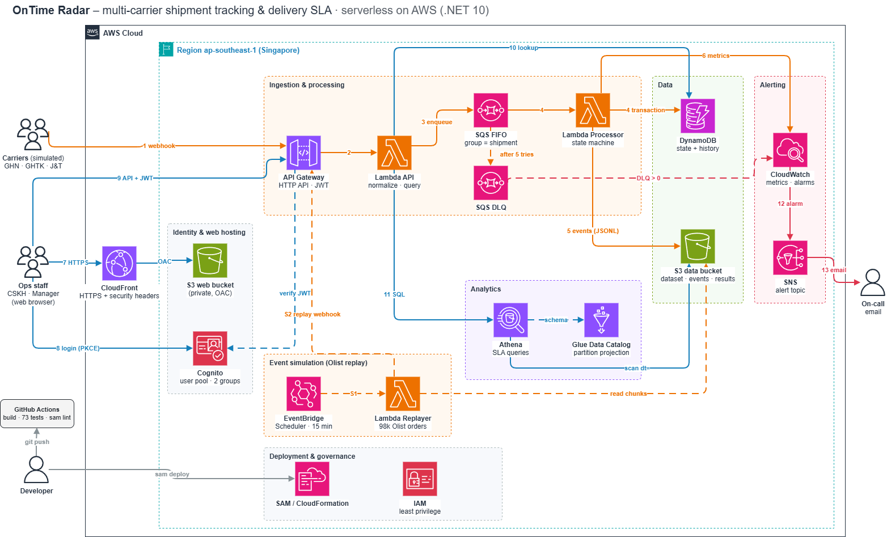
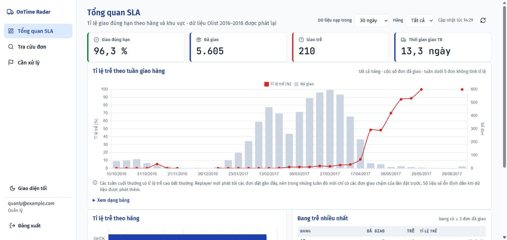
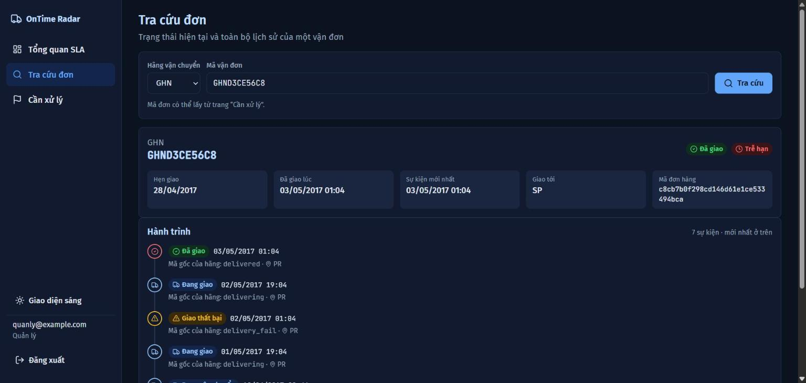
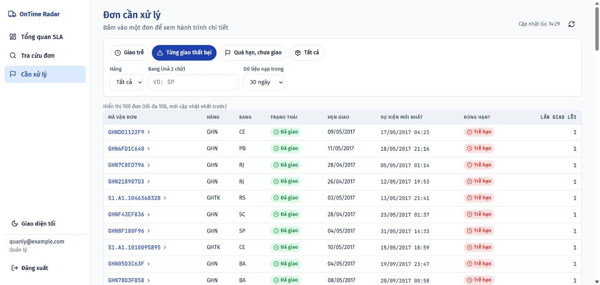

# Shipment SLA Service

**Multi-carrier shipment tracking & delivery-SLA backend on AWS (serverless, .NET 10).**

Nhận webhook trạng thái từ nhiều hãng vận chuyển (GHN / GHTK / J&T – định dạng mô phỏng),
chuẩn hóa về 1 mô hình trạng thái, xử lý **đúng thứ tự từng vận đơn**, lưu timeline,
phát hiện **đơn giao trễ** gần realtime và lưu toàn bộ sự kiện để phân tích SLA.
Traffic thật hằng ngày đến từ **Replayer** phát lại ~99k đơn hàng thật của bộ dữ liệu Olist.

→ Value, người dùng, khách hàng mục tiêu: [docs/product.md](docs/product.md)

## Kiến trúc



File gốc: [docs/diagrams/architecture.drawio](docs/diagrams/architecture.drawio) (mở bằng draw.io).
Số trên mũi tên ứng với các bước bên dưới; màu của bảng = màu của luồng trên sơ đồ.

**🟠 Luồng 1 – Nhận sự kiện từ hãng vận chuyển**

| Bước | Từ → Đến | Việc gì xảy ra |
| --- | --- | --- |
| 1 | Hãng → API Gateway | Gửi webhook, xác thực bằng header secret (không dùng Cognito) |
| 2 | API Gateway → Lambda API | Adapter của từng hãng chuẩn hóa về 8 trạng thái chung, tạo `eventId` |
| 3 | Lambda API → SQS FIFO | Xếp hàng theo vận đơn (`MessageGroupId`), trả `202` ngay cho hãng |
| 4 | SQS → Processor → DynamoDB | State machine quyết định `Applied` / `Stale` / `Rejected` / `Duplicate`, ghi trạng thái + lịch sử bằng 1 transaction |
| 5 | Processor → S3 | Ghi sự kiện vào `events/dt=YYYY-MM-DD/` (JSONL) để phân tích |
| 6 | Processor → CloudWatch | Đẩy số đơn đã giao và số đơn giao trễ (theo hãng) |
| DLQ | SQS → DLQ | Message lỗi 5 lần → chuyển sang DLQ, có cảnh báo |
| S1–S2 | Scheduler → Replayer → API Gateway | Mỗi 15 phút đọc đơn Olist thật từ S3 và phát lại thành webhook – đi đúng đường như hãng thật |

**🔵 Luồng 2 – Nhân viên dùng dashboard**

| Bước | Từ → Đến | Việc gì xảy ra |
| --- | --- | --- |
| 7 | Trình duyệt → CloudFront → S3 web | Tải website qua HTTPS; bucket khoá kín, chỉ CloudFront đọc được (OAC) |
| 8 | Trình duyệt → Cognito | Đăng nhập (OAuth code + PKCE), nhận token có nhóm `cskh` hoặc `manager` |
| 9 | Trình duyệt → API Gateway | Gọi API kèm JWT: cổng chặn token sai/hết hạn (401), Lambda chặn sai vai trò (403) |
| 10 | Lambda API → DynamoDB | Tra cứu đơn: 1 lần Query lấy trạng thái + toàn bộ lịch sử |
| 11 | Lambda API → Athena → S3 | Báo cáo SLA: SQL trên kho sự kiện (schema ở Glue), chỉ quét các ngày cần, tối đa 1 GB/truy vấn |

**🔴 Luồng 3 – Cảnh báo**

| Bước | Từ → Đến | Việc gì xảy ra |
| --- | --- | --- |
| 12 | CloudWatch → SNS | Tỉ lệ giao trễ ≥ 20 % trong 2/3 khung 15 phút liên tiếp, hoặc DLQ > 0 |
| 13 | SNS → Email | Gửi email khi có sự cố (kèm link trang *Cần xử lý*) và khi đã trở lại bình thường |

**⚪ Deploy** – `git push` → GitHub Actions (test, chờ duyệt) → OIDC → IAM role tạm (≤ 1 giờ) →
SAM / CloudFormation. Không có access key nào lưu trên GitHub – xem [2a](#2a-deploy-tự-động-github-actions--oidc).

Vì sao chọn từng thiết kế: xem [7. Thiết kế đáng chú ý](#7-thiết-kế-đáng-chú-ý-để-trình-bày).

## Ảnh giao diện

Dashboard web (S3 + CloudFront, đăng nhập Cognito). Email trên ảnh đã được thay bằng `quanly@example.com`.

| Tổng quan SLA (Quản lý) | Tra cứu đơn – chế độ tối |
| --- | --- |
|  |  |

**Cần xử lý** – lọc nhanh đơn giao trễ / từng giao thất bại / quá hạn, bấm 1 dòng để xem hành trình:



## Cấu trúc thư mục

| Đường dẫn | Nội dung |
| --- | --- |
| `src/ShipmentSla.Core` | Nghiệp vụ thuần (không phụ thuộc AWS): model, **state machine**, adapter 3 hãng, simulator |
| `src/ShipmentSla.Infrastructure` | Truy cập DynamoDB (single-table, transaction, idempotency) |
| `src/ShipmentSla.Api` | Minimal API chạy trên Lambda (webhook + tra cứu) |
| `src/ShipmentSla.Processor` | Lambda đọc SQS FIFO → DynamoDB + S3 + CloudWatch metric |
| `src/ShipmentSla.Replayer` | Lambda phát lại đơn Olist thành webhook |
| `tests/ShipmentSla.Core.Tests` | xUnit: state machine, adapter, round-trip simulator |
| `tests/ShipmentSla.Service.Tests` | Code chạm AWS với AWS **giả** (không cần tài khoản / Docker): `ShipmentStore` trên DynamoDB giả trong bộ nhớ, Processor (lỗi giữa batch FIFO), API thật trong bộ nhớ (phân quyền 401/403, webhook), luật Replayer |
| `tools/prepare_olist.py` | Chuyển CSV Olist → `chunks/*.jsonl` cho Replayer |
| `tools/sample-data/` | 6 đơn **giả lập** đúng định dạng Olist để test trước khi tải Kaggle |
| `template.yaml` | Toàn bộ hạ tầng (AWS SAM / CloudFormation), gồm Glue database/table + Athena workgroup |
| `.github/workflows/ci.yml` | CI: build + test .NET, `sam validate --lint` |
| `.github/workflows/deploy.yml` | CD: test → chờ duyệt → OIDC → `sam deploy` + website + kiểm tra `/health` |
| `infra/github-oidc.yaml` | OIDC provider + IAM role cho GitHub Actions (deploy 1 lần, tách khỏi stack chính) |

## 0. Cài đặt (1 lần)

| Công cụ | Kiểm tra |
| --- | --- |
| .NET SDK **10** | `dotnet --list-sdks` |
| AWS CLI v2 (đã `aws configure` / SSO, region `ap-southeast-1`) | `aws sts get-caller-identity` |
| AWS SAM CLI (bản mới – cần hỗ trợ runtime `dotnet10`) | `sam --version` |
| Amazon.Lambda.Tools | `dotnet tool install -g Amazon.Lambda.Tools` |
| Python 3.10+ | `python --version` |

> Vì sao .NET 10: runtime `dotnet8` của Lambda đã **deprecated từ 10/11/2026**; `dotnet10` là bản LTS hiện tại.

## 1. Build & test ở máy (không cần AWS)

```powershell
cd shipment-sla-service
dotnet build
dotnet test        # 182 test: Core (state machine, adapter…) + Service (DynamoDB/SQS/S3/Athena giả)
```

Test ưu tiên 3 chỗ dễ mất / sai dữ liệu nhất, đều đã thử **cố ý làm hỏng code** để chắc test bắt được (mutation test):

| Vùng | Test chính | Làm hỏng thử → test đỏ |
| --- | --- | --- |
| `ShipmentStore` | Transaction 2 item, `Duplicate` không ghi gì, **xung đột version không bị nhận nhầm là `Duplicate`**, phân trang lịch sử | Nhận diện trùng bằng "bất kỳ lý do nào" → S4 đỏ |
| Processor | Lỗi giữa batch FIFO: message lỗi **và mọi message sau** báo lỗi, không được xử lý; S3/CloudWatch lỗi không làm hỏng batch | Bỏ quy tắc FIFO → 2 test đỏ |
| Phân quyền | Ma trận 401/403 qua toàn bộ pipeline; **mọi route GET (trừ `/health`) phải có `RequireAccess`** | Bỏ filter khỏi `/sla/trend` → 2 test đỏ |

`FakeDynamoTable` chỉ hiểu đúng các lệnh / điều kiện code đang dùng và ném `NotSupportedException` với mọi thứ khác,
nên đổi code mà quên cập nhật bản giả sẽ lộ ngay. Phần tích hợp thật vẫn kiểm trên AWS bằng `demo.ps1` (cảnh 2)
và `daily-check.ps1 -AuthMatrix`.

## 2. Deploy lên AWS

```powershell
Copy-Item samconfig.example.toml samconfig.toml
sam build
sam deploy --guided
#   WebhookSecret      : chuỗi ngẫu nhiên ≥ 16 ký tự (ghi lại)
#   AlertEmail         : email nhận cảnh báo
#   ReplayState        : DISABLED   (bật sau khi test xong)
#   OrdersPerRun       : 20
#   LateRatePercent    : 20   (cảnh báo khi tỉ lệ trễ ≥ 20 % trong 2/3 khung 15 phút)
#   MinDeliveries      : 10   (khung 15 phút chỉ tính khi có ≥ 10 đơn đã giao)
#   Save arguments to configuration file: Y
```

Sau khi deploy: **mở email, bấm Confirm subscription** của SNS. Ghi lại các Outputs
(`ApiUrl`, `DataBucketName`, `TableName`, `ReplayerFunctionName`, `UserPoolId`).

## 2a. Deploy tự động (GitHub Actions + OIDC)

Sau khi cài 1 lần, mỗi lần push lên `main` có thay đổi ở `src/`, `template.yaml`, `web/` hoặc
`global.json`: **test → chờ bạn bấm Approve → deploy stack → tải website → kiểm tra `/health`**.
Sửa tài liệu thì không deploy. Có thể chạy tay: tab *Actions* → *Deploy* → *Run workflow*.

**Cài 1 lần (~10 phút):**

```powershell
# 1) Tạo OIDC provider + role deploy (chạy từ máy, bằng tài khoản quản trị)
aws cloudformation deploy --stack-name github-oidc-deploy --template-file infra/github-oidc.yaml `
    --capabilities CAPABILITY_NAMED_IAM --region ap-southeast-1
#    (tài khoản đã có OIDC provider của GitHub → thêm: --parameter-overrides CreateOidcProvider=false)
#    Cập nhật stack ĐÃ CÓ: lệnh này giữ giá trị cũ của tham số không truyền vào (kể cả khi đổi Default
#    trong file) → muốn đổi thì truyền rõ, vd. --parameter-overrides "GitHubRepo=owner@id/repo@id"

# 2) Lấy ARN của role (dùng ở bước 4, KHÔNG phải access key)
aws cloudformation describe-stacks --stack-name github-oidc-deploy --region ap-southeast-1 `
    --query "Stacks[0].Outputs[?OutputKey=='DeployRoleArn'].OutputValue" --output text
```

3. GitHub → *Settings* → *Environments* → **New environment** `production`
   → bật **Required reviewers** (chọn chính bạn) → *Deployment branches*: chỉ `main`.
4. Trong environment `production` → **Add environment secret** `AWS_DEPLOY_ROLE_ARN` = ARN ở bước 2.
5. *Actions* → *Deploy* → *Run workflow* → *Review deployments* → **Approve**.

**Lưu ý:**

- Workflow **không truyền tham số** → SAM giữ nguyên giá trị cũ trong stack (`WebhookSecret`, `AlertEmail`,
  `ReplayState`…), nên không có bí mật nào trên GitHub. Muốn **đổi** một tham số hoặc thêm tham số mới
  → deploy 1 lần từ máy (`sam deploy` dùng `samconfig.toml`).
- Role chỉ nhận token khi đủ 3 điều kiện: đúng repo, đúng environment `production` (đã được duyệt),
  audience `sts.amazonaws.com`. Token hết hạn sau ≤ 1 giờ.
  Repo được nhận diện bằng **ID cố định** của GitHub (`owner@id/repo@id` trong claim `sub`), nên tạo lại
  repo trùng tên cũng không giả mạo được. Fork/đổi chủ repo → sửa tham số `GitHubRepo` (lấy ID trong
  CloudTrail, sự kiện `AssumeRoleWithWebIdentity` bị từ chối).
- Quyền của role giới hạn theo dịch vụ stack dùng và theo tên `shipment-sla-*` khi AWS cho phép
  (CloudFormation, IAM role, Lambda, SQS, DynamoDB, S3, log, SNS, alarm). API Gateway, Cognito và CloudFront
  dùng ID tự sinh nên chỉ giới hạn được theo dịch vụ. Role deploy hạ tầng luôn có quyền lớn
  (tạo được Lambda, IAM role) – lớp bảo vệ chính là **điều kiện tin cậy + bước duyệt + không có key dài hạn**,
  thêm **permissions boundary**: role deploy chỉ tạo/sửa được role có gắn boundary `shipment-sla-boundary`
  (trần quyền: log, DynamoDB/SQS/S3/Athena/Glue của stack, PutMetricData, gọi Lambda của stack).
- Thêm quyền mới cho Lambda (vd. dịch vụ AWS khác) → phải thêm vào **cả** `Policies` trong `template.yaml`
  **và** boundary trong `infra/github-oidc.yaml` (cập nhật stack `github-oidc-deploy` trước), nếu không
  Lambda sẽ bị `AccessDenied` dù policy đã cho phép.
- Log của repo public là công khai: số tài khoản AWS được che (`***`) trong log.

## 2b. Đăng nhập (Cognito)

Xem dữ liệu cần đăng nhập; webhook của hãng vẫn dùng `X-Webhook-Secret`, `/health` công khai.

| Chức năng | Chưa đăng nhập | Chưa gán nhóm | `cskh` (CSKH) | `manager` (Quản lý) |
| --- | --- | --- | --- | --- |
| `GET /shipments`, `GET /shipments/{carrier}/{tracking}` | 401 | 403 | ✅ | ✅ |
| `GET /sla/summary`, `GET /sla/trend` | 401 | 403 | 403 | ✅ |

Không có tự đăng ký – admin tạo tài khoản, Cognito gửi **mật khẩu tạm** qua email:

```powershell
$pool = "<UserPoolId>"
aws cognito-idp admin-create-user --user-pool-id $pool --username nhanvien@example.com `
  --user-attributes Name=email,Value=nhanvien@example.com Name=email_verified,Value=true
aws cognito-idp admin-add-user-to-group --user-pool-id $pool --username nhanvien@example.com --group-name cskh   # hoặc manager
```

Lấy token (lần đầu sẽ bắt đổi mật khẩu tạm; có MFA thì hỏi mã 6 số; token hạn 1 giờ):

```powershell
$token = .\tools\get-token.ps1 -Email nhanvien@example.com
$auth  = @{ Authorization = "Bearer $token" }
```

MFA (app Authenticator) là **tuỳ chọn**, mỗi người tự bật. Trang đăng nhập của Cognito (dùng cho website)
nằm ở Output `LoginUrl`.

## 3. Smoke test API

```powershell
$api    = "<ApiUrl>"
$secret = "<WebhookSecret>"
$h      = @{ "X-Webhook-Secret" = $secret }

Invoke-RestMethod "$api/health"

# Hãng GHN báo đã lấy hàng, rồi giao trễ 1 ngày so với dự kiến (19/11)
Invoke-RestMethod -Method Post "$api/carriers/ghn/webhook" -Headers $h -ContentType "application/json" -InFile tools/sample-webhook-ghn.json
Invoke-RestMethod -Method Post "$api/carriers/ghn/webhook" -Headers $h -ContentType "application/json" -InFile tools/sample-webhook-ghn-delivered.json

Start-Sleep 5
Invoke-RestMethod "$api/shipments/ghn/GHNTEST001" -Headers $auth | ConvertTo-Json -Depth 5   # $auth: mục 2b
# → status Delivered, isLate true, 2 events Applied
# Không có token → 401

# Gửi lại đúng webhook cũ → không tạo trùng (idempotent)
Invoke-RestMethod -Method Post "$api/carriers/ghn/webhook" -Headers $h -ContentType "application/json" -InFile tools/sample-webhook-ghn.json
# Sai secret → 401
Invoke-RestMethod -Method Post "$api/carriers/ghn/webhook" -Headers @{ "X-Webhook-Secret" = "wrong" } -ContentType "application/json" -InFile tools/sample-webhook-ghn.json
```

## 4. Chạy thử Replayer với dữ liệu mẫu

```powershell
$bucket = "<DataBucketName>"
python tools/prepare_olist.py --input tools/sample-data --output data/sample-prepared
aws s3 sync data/sample-prepared/chunks "s3://$bucket/dataset/chunks/"

sam remote invoke ReplayerFunction --stack-name shipment-sla
# → {"Orders":5,"Sent":22,"Failed":0,...}

aws s3 ls "s3://$bucket/events/" --recursive     # file JSONL của event lake
aws logs tail "/aws/lambda/<tên ProcessorFunction>" --since 10m
```

## 5. Dữ liệu thật Olist (≈99k đơn)

1. Tải **Brazilian E-Commerce Public Dataset by Olist** trên Kaggle (cần tài khoản Kaggle),
   giải nén vào `data/olist/` (thư mục `data/` đã nằm trong `.gitignore`).
2. Chuẩn bị và thay dữ liệu mẫu:

```powershell
python tools/prepare_olist.py --input data/olist --output data/prepared
aws s3 rm "s3://$bucket/dataset/chunks/" --recursive
aws s3 sync data/prepared/chunks "s3://$bucket/dataset/chunks/"
aws dynamodb delete-item --table-name <TableName> --key file://tools/replay-cursor-key.json   # về đầu dataset
sam remote invoke ReplayerFunction --stack-name shipment-sla                                  # 1 lượt thử
```

3. **Bật lịch 15 phút:** trong `samconfig.toml` sửa `ReplayState=\"DISABLED\"` → `ReplayState=\"ENABLED\"`, rồi:

```powershell
sam build; sam deploy
```

Với 20 đơn/lượt × 96 lượt/ngày ≈ 1.900 đơn (~9.000 sự kiện)/ngày → dữ liệu đủ chạy ~50 ngày.

## 5b. Báo cáo SLA (Athena)

Bảng Glue `events` dùng **partition projection** theo `dt`, nên dữ liệu mới vào S3 là truy vấn được ngay,
không cần crawler hay `MSCK REPAIR`.

```powershell
# $auth: token của tài khoản manager (mục 2b). /shipments dùng được cả tài khoản cskh.
Invoke-RestMethod "$api/sla/summary" -Headers $auth                          # 30 ngày, theo hãng
Invoke-RestMethod "$api/sla/summary?days=7&groupBy=region" -Headers $auth    # 7 ngày, theo bang
# → { days, groupBy, rows: [ { group, delivered, late, latePercent } ] }

Invoke-RestMethod "$api/sla/trend?carrier=ghn" -Headers $auth                # theo ngày giao: số đơn, % trễ, số ngày giao TB
Invoke-RestMethod "$api/shipments?late=true&limit=20" -Headers $auth         # danh sách đơn đã giao trễ
Invoke-RestMethod "$api/shipments?status=InTransit&carrier=jt&region=SP" -Headers $auth
Invoke-RestMethod "$api/shipments?overdue=true" -Headers $auth               # đơn chưa xong nhưng đã quá ngày hẹn
```

| Endpoint | Tham số (đều tuỳ chọn) |
| --- | --- |
| `GET /shipments` | `days` 1–365 · `limit` 1–200 · `status` (tên trạng thái) · `carrier` ghn/ghtk/jt · `region` 2–10 chữ cái · `late` · `overdue` |
| `GET /sla/summary` | `days` · `groupBy` carrier/region |
| `GET /sla/trend` | `days` · `carrier` |

Tham số sai → **400** kèm lý do. Trình duyệt gọi được API (CORS, chỉ `GET`); giới hạn domain bằng tham số
`CorsAllowOrigin` khi deploy.

Muốn truy vấn tay thì mở Athena Console, chọn workgroup `shipment-sla-wg`, database `shipment_sla_lake`:

```sql
SELECT carrier, count(*) AS delivered, count_if(islate) AS late
FROM shipment_sla_lake.events
WHERE dt >= '2026-11-01' AND status = 'Delivered' AND outcome = 'Applied'
GROUP BY carrier;
```

## 5c. Demo giá trị thực tế

```powershell
.\tools\demo.ps1 -Email quanly@example.com              # 5 cảnh, Enter để chuyển cảnh (cảnh 4 gửi email cảnh báo thật)
.\tools\demo.ps1 -Email quanly@example.com -SkipAlarm   # bỏ cảnh cảnh báo email
# -Email: tài khoản nhóm manager, mật khẩu được hỏi ẩn
```

| Cảnh | Nỗi đau | Hệ thống chứng minh |
| --- | --- | --- |
| 1 | Mỗi hãng một định dạng, một mã trạng thái | 3 webhook khác nhau → cùng trạng thái `OutForDelivery` |
| 2 | Webhook trùng, sai thứ tự, quét nhầm | 8 webhook → trạng thái cuối vẫn `Delivered`; trùng bị loại, cũ = `Stale`, đi lùi = `Rejected` |
| 3 | CSKH mở nhiều trang để tra 1 đơn | 1 lần gọi API ra toàn bộ timeline của 1 đơn Olist thật |
| 4 | Biết giao trễ khi khách phàn nàn | 5 đơn trễ / giờ → alarm → email trong vài phút |
| 5 | Chọn hãng theo cảm tính | Tỉ lệ đúng hạn theo hãng & bang từ Athena |

Đơn demo có mã bắt đầu bằng `DEMO` và **không tính vào** `/sla/summary`.

## 5d. Website dashboard (`web/`)

HTML/CSS/JS thuần (không build, ~90 KB) + Chart.js từ CDN. Thiết kế theo skill *ui-ux-pro-max*
(Swiss / tối giản, dày thông tin), font Fira Sans + JetBrains Mono (có dấu tiếng Việt), sáng/tối theo máy.

| Trang | Ai thấy | Dữ liệu |
| --- | --- | --- |
| Tổng quan SLA | Quản lý | KPI, tỉ lệ trễ theo tuần, theo hãng, bang trễ nhiều nhất |
| Tra cứu đơn | CSKH + Quản lý | Trạng thái + dòng thời gian của 1 vận đơn (link `#/lookup/<hãng>/<mã>`) |
| Cần xử lý | CSKH + Quản lý | Đơn giao trễ / từng giao thất bại / quá hạn chưa giao, lọc theo hãng, bang |

Chạy thử ở máy (đăng nhập qua trang Cognito, quay về `http://localhost:5500/`):

```powershell
.\tools\make-web-config.ps1                                   # sinh web/js/config.js từ Outputs của stack
py -m http.server 5500 --bind 127.0.0.1 --directory web       # mở http://localhost:5500 (dùng "localhost", không phải 127.0.0.1)
```

Đưa lên mạng (S3 + CloudFront, link ở Output `WebUrl`):

```powershell
sam build; sam deploy            # lần đầu tạo bucket web + CloudFront (~5–10 phút)
.\tools\deploy-web.ps1           # mỗi lần sửa web/: tải lên S3 + xoá cache CloudFront
```

Bảo mật: đăng nhập OAuth code + PKCE (không có secret trong trình duyệt), token chỉ nằm trong tab
(sessionStorage), Content-Security-Policy, Chart.js có SRI, mọi dữ liệu từ API đều được escape.
Trên CloudFront: bucket web **riêng và khoá kín** (chỉ CloudFront đọc được qua OAC), HTTPS bắt buộc,
header bảo mật (CSP + `frame-ancestors 'none'`, HSTS, `X-Frame-Options`, `nosniff`, `no-referrer`).
CORS của API và địa chỉ quay về của Cognito chỉ chấp nhận domain CloudFront và `http://localhost:5500`.

## 6. Kiểm tra hằng ngày (5 phút)

Một lệnh, chỉ đọc, ~40 giây – 10 mục ĐẠT / CẢNH BÁO / LỖI kèm gợi ý xử lý (mã thoát 1 nếu có LỖI):

```powershell
.\tools\daily-check.ps1                            # in kết quả
.\tools\daily-check.ps1 -SaveTo docs\evidence      # + lưu .txt làm bằng chứng (xem docs/evidence/README.md)
```

Hoặc xem tay:

- CloudWatch → Lambda `ReplayerFunction`: có chạy mỗi 15 phút, `Failed = 0`.
- SQS DLQ = 0 message (nếu > 0 sẽ có email cảnh báo).
- `aws s3 ls s3://$bucket/events/` có thư mục `dt=` của hôm nay.
- Mỗi tuần: chụp Cost Explorer (lọc theo service) → lưu vào `docs/evidence/`.

## 7. Thiết kế đáng chú ý (để trình bày)

| Quyết định | Lý do |
| --- | --- |
| **SQS FIFO, MessageGroupId = vận đơn** | Sự kiện của 1 vận đơn xử lý đúng thứ tự; các vận đơn khác vẫn song song |
| **eventId xác định (hash)** + điều kiện DynamoDB | Webhook gửi trùng → `Duplicate`, không xử lý 2 lần (idempotent) |
| **Transaction DynamoDB + version** | Lịch sử và trạng thái luôn khớp; 2 writer không ghi đè nhau |
| **State machine theo rank** | Chặn đi lùi / sau trạng thái kết thúc; sự kiện cũ đến muộn = `Stale` |
| **Adapter mỗi hãng** | Thêm hãng mới = thêm 1 class, không sửa luồng xử lý |
| **Partial batch failure** | Chỉ message lỗi quay lại hàng đợi; sau 5 lần → DLQ + alarm |
| **Serverless, arm64, on-demand** | Không VPC/NAT, trả theo request; log giữ 14 ngày |
| **Athena + partition projection** | Phân tích SLA trên S3, không cần crawler; lọc theo `dt` để chỉ quét phần dữ liệu cần; workgroup chặn ở 1 GB/query |
| **Whitelist `groupBy`, `days` là số nguyên** | Không đưa chuỗi người dùng nhập vào SQL (chống SQL injection) |
| **Cognito + JWT authorizer của API Gateway** | Token sai/hết hạn bị chặn ở cổng (401) trước khi tốn tiền chạy Lambda; không tự viết code kiểm tra chữ ký |
| **Cảnh báo theo TỈ LỆ trễ, 2/3 khung 15 phút** | Ngưỡng "số đơn trễ / giờ" bật tắt liên tục khi lượng đơn tăng (alert fatigue); tỉ lệ + yêu cầu kéo dài → ít email giả, có email "đã hết sự cố" |
| **CloudFront + S3 riêng khoá kín (OAC)** | Website chạy HTTPS toàn cầu gần như 0 USD; không ai đọc thẳng được bucket, bucket web tách khỏi dữ liệu đơn hàng |
| **Phân quyền theo nhóm trong code (`AccessRules`)** | API Gateway không phân quyền theo nhóm Cognito được → lớp thứ 2 trả 403, có unit test cho ma trận quyền |
| **Cache kết quả Athena 2 lớp** (bộ nhớ Lambda 5 phút + Athena *query result reuse* 15 phút) | Dữ liệu chỉ đổi mỗi 15 phút (lịch Replayer) → mở lại dashboard không cần chạy lại truy vấn. **Đo thật (20/11/2026, 38 truy vấn):** quét S3 ≈ 2,4 s · Athena dùng lại kết quả ≈ 0,55 s · bộ nhớ ≈ 0 ms; **79 % truy vấn không phải quét S3**. Có 4 bản Lambda chạy song song (mỗi bản bộ nhớ riêng) → lớp Athena đỡ cho bản chưa có cache. Đã cân nhắc bảng tổng hợp DynamoDB: nhanh hơn nữa nhưng thêm 1 nguồn số liệu phải giữ khớp và phải nạp lại dữ liệu cũ – để dành khi dữ liệu/người dùng lớn |
| **Throttling API Gateway: 10 req/s, burst 20 mỗi route** | Quá giới hạn → 429 ngay ở cổng, Lambda không chạy → một đợt dồn request không thể chiếm hết 10 Lambda chạy song song của tài khoản hay đẩy hoá đơn lên. Replayer và `demo.ps1` gửi lại khi gặp 429 (cùng payload = cùng `eventId`, không bị áp dụng 2 lần) |
| **Kiểm tra mã vận đơn `^[A-Za-z0-9._-]{1,64}$`** ở cả 3 adapter | Mã vận đơn đi vào khoá DynamoDB (`ghn#MÃ`), URL, S3/Athena → chặn `#`, `/`, khoảng trắng, xuống dòng, ký tự lạ ngay từ webhook (400). Dùng `\z` thay `$` vì `$` của .NET chấp nhận `"ABC\n"` |
| **Permissions boundary** cho mọi role của stack | Role deploy chỉ được tạo/sửa role **có gắn boundary** → kể cả token GitHub bị lộ cũng không tạo được role admin cho Lambda. Boundary nằm ở stack `infra/` (stack ứng dụng không tự nới được), có Deny tường minh việc gỡ / sửa boundary |
| **Deploy qua GitHub Actions + OIDC, có bước duyệt** | Không có access key dài hạn để lộ; role chỉ tin đúng repo + environment `production`; stack quyền tách riêng nên deploy lỗi không tự xoá quyền deploy |

## 8. Chi phí & dọn dẹp

Ước tính với lịch 15 phút: **khoảng 3–5 USD/tháng** (DynamoDB write chiếm nhiều nhất).
Đây là ước tính – dùng Cost Explorer để lấy số thật cho báo cáo.

```powershell
# Chỉ khi đã nộp và được chấm xong:
aws s3 rm "s3://$bucket" --recursive
sam delete --stack-name shipment-sla
```

## Lộ trình

- [x] Tuần 1: webhook 3 hãng, SQS FIFO, Processor, DynamoDB, Replayer, alarm trễ + DLQ
- [x] Tuần 2: Glue Data Catalog + Athena (`GET /sla/summary`), GitHub Actions CI
- [x] API cho dashboard: `GET /shipments` (danh sách), `GET /sla/trend`, CORS
- [x] Cognito: đăng nhập, 2 vai trò CSKH / Quản lý, MFA tuỳ chọn
- [x] Website dashboard chạy ở máy (3 trang, đăng nhập Cognito, sáng/tối)
- [x] Đưa website lên S3 + CloudFront
- [x] Deploy AWS, chạy dữ liệu Olist thật, bật lịch 15 phút, xác nhận email cảnh báo
- [x] Script demo `tools/demo.ps1`
- [x] Deploy tự động bằng GitHub Actions + OIDC, có bước duyệt (chạy thành công 20/11/2026)
- [ ] Sơ đồ kiến trúc PNG, evidence, video demo

## Dữ liệu

Olist Brazilian E-Commerce Public Dataset (Kaggle, CC BY-NC-SA 4.0). Thời điểm đặt hàng, lấy hàng,
giao hàng, ngày hẹn giao và bang là **thật**; hãng vận chuyển, mã vận đơn, các mốc
InTransit/OutForDelivery và FailedAttempt là **giả lập** (xem `tools/prepare_olist.py`).
