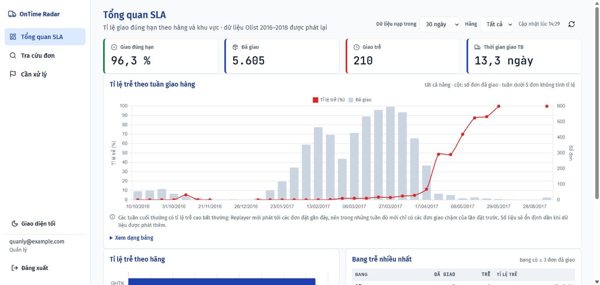

# Shipment SLA Service – Định nghĩa sản phẩm

> Dự án portfolio trong khuôn khổ AWS FCAJ. Dữ liệu là **đơn hàng thật lịch sử (Olist, 2016–2018)**
> được phát lại (replay) như sự kiện realtime; định dạng webhook của các hãng là **mô phỏng**,
> không phải đặc tả chính thức của GHN / GHTK / J&T.

## 1. Vấn đề

Shop bán hàng online ở Việt Nam thường giao qua **2–4 hãng vận chuyển** cùng lúc
(GHN, GHTK, J&T, Viettel Post...). Mỗi hãng:

- có **mã trạng thái riêng** (`delivering`, `status_id = 45`, `scanType = DELIVERY`...),
- có **trang tra cứu riêng**, webhook riêng.

Hậu quả:

| Nỗi đau | Ảnh hưởng |
| --- | --- |
| Nhân viên mở nhiều trang để tra 1 đơn | Mất thời gian, CSKH trả lời chậm |
| Biết đơn giao trễ khi **khách phàn nàn** | Mất uy tín, đánh giá xấu, hoàn hàng |
| Không có số liệu đúng hạn theo hãng / khu vực | Chọn hãng theo cảm tính, không đàm phán được giá/SLA |
| Webhook đến trùng, sai thứ tự | Trạng thái trên hệ thống bị nhảy lùi, sai lệch |

## 2. Giải pháp (value)

Một backend nhận sự kiện từ mọi hãng và trả về **một sự thật duy nhất** cho mỗi vận đơn,
kèm **dashboard web** để nhân viên dùng hằng ngày.

1. **Chuẩn hóa đa hãng** – mỗi hãng một adapter, quy về 8 trạng thái chung.
2. **Timeline 1 chỗ** – `GET /shipments/{id}` trả trạng thái hiện tại + toàn bộ lịch sử.
3. **Chống sai lệch** – loại sự kiện trùng (idempotent), bỏ qua sự kiện cũ đến muộn,
   chặn chuyển trạng thái vô lý (DELIVERED → IN_TRANSIT).
4. **Cảnh báo giao trễ** – tỉ lệ đơn giao sau ngày cam kết vượt ngưỡng trong 2/3 khung 15 phút
   → CloudWatch alarm → email (kèm link trang *Cần xử lý*), và email khi đã trở lại bình thường.
5. **Phân tích SLA** – lưu toàn bộ sự kiện vào S3, truy vấn Athena: tỉ lệ đúng hạn
   theo hãng, theo tỉnh/bang, theo tuần, thời gian vận chuyển trung bình.
6. **Dashboard web** – 3 trang: *Tổng quan SLA*, *Tra cứu đơn* (dòng thời gian), *Cần xử lý*
   (đơn giao trễ / từng giao thất bại / quá hạn). Chạy trên CloudFront, sáng/tối, dùng được trên điện thoại.
7. **Đăng nhập & phân quyền** – Cognito, tài khoản do quản trị viên cấp, MFA tuỳ chọn;
   vai trò **CSKH** chỉ tra cứu đơn, **Quản lý** xem thêm báo cáo SLA.



*Trang Tổng quan SLA (19/11/2026). Thêm ảnh: [README – Ảnh giao diện](../README.md#ảnh-giao-diện).*

**Câu pitch:** *Backend + dashboard theo dõi vận đơn đa hãng: chuẩn hóa trạng thái, phát hiện đơn trễ
gần realtime và đo tỉ lệ giao đúng hạn theo hãng & khu vực – serverless, có đăng nhập phân quyền,
chi phí vài USD/tháng.*

## 3. Ai sử dụng (users)

| Người dùng | Vai trò đăng nhập | Họ cần gì | Dùng tính năng nào |
| --- | --- | --- | --- |
| **CSKH** | `cskh` | Trả lời "đơn tôi đâu?" trong vài giây | Web: *Tra cứu đơn*, *Cần xử lý* |
| **Nhân viên vận hành (Ops)** | `cskh` | Biết ngay đơn nào có vấn đề | Email cảnh báo trễ, web: *Cần xử lý* |
| **Quản lý vận hành / chủ shop** | `manager` | Chọn hãng tốt cho từng khu vực | Web: *Tổng quan SLA* (+ mọi trang của CSKH) |
| **Hãng vận chuyển** (hệ thống) | – (secret webhook) | Đẩy trạng thái qua webhook | `POST /carriers/{carrier}/webhook` |
| **Hệ thống khác** (OMS, website shop) | token Cognito | Lấy trạng thái chuẩn hóa qua API | REST API (`GET /shipments…`, `/sla/…`) |

## 4. Khách hàng mục tiêu (ai trả tiền – giả thuyết)

1. **Nhà bán hàng SME đa kênh** (Shopee, TikTok Shop, Lazada + website riêng),
   khoảng 50–2.000 đơn/ngày, dùng từ 2 hãng trở lên. → Khách hàng chính.
2. **Đơn vị fulfillment / 3PL nhỏ** – giao hộ nhiều shop, cần báo cáo SLA để báo cáo lại cho shop.
3. **Nền tảng quản lý bán hàng (OMS/POS)** – tích hợp như một module tracking.

Đây là giả thuyết để định hướng thiết kế; dự án **không** khảo sát thị trường thật.

## 5. Chỉ số đo được (KPI của hệ thống)

| KPI | Cách đo |
| --- | --- |
| Số sự kiện xử lý / ngày | CloudWatch Lambda Invocations, số dòng S3 |
| Tỉ lệ sự kiện bị loại (trùng / cũ / vô lý) | Trường `outcome` trong lịch sử |
| Độ trễ từ webhook → trạng thái cập nhật | `processedAt - receivedAt` |
| Tỉ lệ giao đúng hạn theo hãng / khu vực | Athena (dashboard *Tổng quan SLA*) |
| Sức khoẻ hệ thống mỗi ngày | `tools/daily-check.ps1` |
| Chi phí AWS / tháng | Cost Explorer (số thật) |

**Số liệu thực đo** (19/11/2026, dữ liệu nạp trong 30 ngày, đã phát ~5.700/98.202 đơn Olist):

| Chỉ số | Giá trị |
| --- | --- |
| Đơn đã giao | 5.425 |
| Giao đúng hạn | 96,4 % |
| Thời gian giao trung bình | 13,3 ngày |
| Sự kiện được Replayer gửi | ~500 / giờ, `Failed = 0` |
| Lỗi Lambda / DLQ (24 giờ) | 0 / 0 |

## 6. Phạm vi

**Đã làm:**
- Tuần 1–2: webhook 3 hãng, chuẩn hóa, xử lý theo thứ tự (SQS FIFO), DynamoDB, lịch sử,
  S3 event lake, cảnh báo trễ, Replayer dữ liệu Olist, Athena SLA, CI (GitHub Actions).
- Mở rộng: API cho dashboard (danh sách đơn, xu hướng theo ngày/tuần), đăng nhập Cognito
  2 vai trò, dashboard web trên S3 + CloudFront, script demo và kiểm tra hằng ngày.

**Ngoài phạm vi:** kết nối API thật của hãng, tính phí vận chuyển, tối ưu tuyến đường,
domain riêng / WAF, nhiều shop dùng chung một hệ thống (multi-tenant), thao tác sửa dữ liệu trên web
(dashboard hiện chỉ đọc).

## 7. Mô hình trạng thái

```
CREATED → PICKED_UP → IN_TRANSIT (lặp lại khi qua kho) → OUT_FOR_DELIVERY → DELIVERED
                                                    ↕
                                              FAILED_ATTEMPT → RETURNED
CREATED → CANCELLED
```

| Quy tắc | Kết quả (`outcome`) |
| --- | --- |
| Sự kiện đã nhận trước đó (cùng `eventId`) | `Duplicate` – bỏ qua |
| Sự kiện xảy ra **trước** sự kiện mới nhất đã áp dụng | `Stale` – lưu lịch sử, không đổi trạng thái |
| Đơn đã ở trạng thái kết thúc (DELIVERED / RETURNED / CANCELLED) | `Rejected` |
| Đi lùi (vd. IN_TRANSIT sau OUT_FOR_DELIVERY) | `Rejected` |
| CANCELLED khi hàng đã được lấy | `Rejected` |
| Còn lại | `Applied` – cập nhật trạng thái |

**Giao trễ** = ngày giao thực tế > ngày giao dự kiến (so theo ngày, giờ UTC).

## 8. Hạn chế đã biết

| Hạn chế | Ảnh hưởng | Hướng xử lý |
| --- | --- | --- |
| Hãng vận chuyển, mã vận đơn, mốc *Đang vận chuyển / Đang giao / Giao thất bại* là **giả lập** | Tỉ lệ giao thất bại không phản ánh hãng thật | Kết nối API/webhook thật của hãng |
| Replayer phát dữ liệu theo **ngày đặt hàng** | Các tuần giao gần nhất chỉ có đơn giao chậm → tỉ lệ trễ bị đẩy lên (dashboard có ghi chú) | Tự ổn định khi phát thêm; hoặc chỉ tính tuần đã "đủ dữ liệu" |
| ~~Cảnh báo trễ dùng ngưỡng số đơn / giờ (5)~~ – **đã xử lý 19/11/2026** | Trước đó alarm bật/tắt 3 lần/ngày khi lượng đơn tăng (alert fatigue) | Đã đổi sang **tỉ lệ trễ ≥ 20 % trong 2/3 khung 15 phút** (≥ 10 đơn/khung), kèm email "đã hết sự cố". Đánh đổi: báo chậm hơn (~30–45 phút) |
| Báo cáo dùng Athena | Lần tải đầu mất ~1–2 giây/truy vấn; số liệu có thể chậm tối đa 5–15 phút do cache (dữ liệu vốn chỉ cập nhật mỗi 15 phút) | Đã thêm cache 2 lớp (20/11/2026): đo được 79 % truy vấn không quét S3, lần tải lại ≈ 0–0,55 s thay vì ≈ 2,4 s. Cần nhanh hơn nữa / nhiều người dùng → bảng tổng hợp theo ngày trong DynamoDB |
| DynamoDB và S3 event lake **không ghi cùng 1 transaction** | Lambda dừng đúng giữa 2 bước (sau khi ghi DynamoDB, trước khi ghi S3) → SQS gửi lại → sự kiện thành `Duplicate` → **có trong DynamoDB nhưng thiếu trong Athena**. Hiếm; S3 lỗi cũng chỉ ghi log. Tra cứu đơn và cảnh báo không bị ảnh hưởng | Có test ghi lại hành vi này (`Known_gap_…`). Sửa: ghi lake từ DynamoDB Streams thay vì từ Processor |
| Tài khoản AWS mới chỉ chạy **10 Lambda cùng lúc** | Đã giới hạn Processor 2 luồng để API không bị 503 | Xin nâng quota lên 1.000 |
| Dữ liệu Olist là **Brazil** (bang SP, RJ…) | Khu vực không phải tỉnh Việt Nam | Thay bằng dữ liệu đơn hàng Việt Nam khi có |
